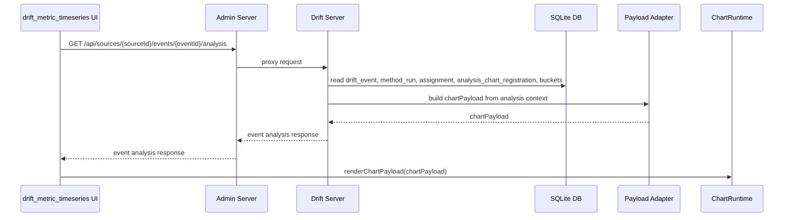

# Architecture Description Language Guide

이 문서는 `drift_llm_intepretation` 전체 시스템의 아키텍처를 기술하기 위한 ADL 폴더의 기준 가이드다.

목표는 새로운 ADL을 만드는 것이 아니라, 이미 검증된 언어를 역할별로 조합해서 다음을 명확히 표현하는 것이다.

- 여러 서버와 UI 모듈이 어떤 이벤트로 연결되는가
- 어떤 상태가 DB, 브라우저, 런타임 내부에 저장되는가
- 어떤 contract가 모듈 사이의 경계를 이룬다
- 어떤 invariant가 깨지면 안 되는가
- 어떤 문서/명세가 어떤 코드와 테스트의 기준이 되는가

## 1. 권장 언어 조합

이 저장소의 아키텍처 기술은 세 계층으로 나눈다.

| 계층 | 권장 언어 | 목적 |
| --- | --- | --- |
| 실행 흐름/상태 전이 | PlusCal/TLA+ | 서버, UI, polling, tick, async request, DB state transition, invariant |
| 데이터/payload contract | CUE | API response, chart payload, method output, adapter binding, managed contract row schema |
| 사람이 읽는 구조도 | Mermaid 또는 Structurizr DSL | 시스템 context, container, component, sequence, deployment view |

하나의 언어로 모든 것을 표현하지 않는다. 각 언어는 자신이 강한 영역만 담당한다.

## 2. 언어별 책임

### 2.1 PlusCal/TLA+

PlusCal/TLA+는 이벤트 순서, 멀티 프로세스, 상태 전이, invariant를 표현한다.

대상:

- `Admin Server`가 source/adapter/method/chart 등록 요청을 보낸다.
- 각 datasource는 정확히 하나의 adapter와 1:1로 연결된다.
- `Test Feeder Server`가 logical time 기준으로 `raw_event`를 주입한다.
- `Drift Server`가 poll을 수행하고 bucket, method run, drift event를 생성한다.
- `Timeseries UI`가 polling으로 timeseries data를 조회한다.
- 사용자가 drift event를 선택하면 event analysis API가 chart payload를 만든다.
- reset, duplicate poll, delayed event, missing chart registration 같은 순서 문제를 검증한다.

PlusCal/TLA+에서 다룰 invariant 예:

- drift event는 대응되는 method run 없이 존재할 수 없다.
- method run은 대응되는 metric bucket 없이 존재할 수 없다.
- datasource 하나는 정확히 하나의 adapter만 가져야 한다.
- adapter 하나는 정확히 하나의 datasource에만 속해야 한다.
- event analysis response는 analysis chart registration 없이 성공할 수 없다.
- 같은 assignment와 bucket 조합으로 method run이 중복 생성되면 안 된다.
- timeseries UI는 server payload를 normalize한 뒤 동일한 render model shape를 유지해야 한다.

PlusCal/TLA+에서 다루지 않을 것:

- 실제 JSON field의 세부 validation
- CSS/layout 표현
- chart component renderer의 DOM 세부 구현
- Python/JavaScript 함수 내부 알고리즘의 수치 계산

### 2.2 CUE

CUE는 데이터 shape와 제약 조건을 표현한다.

대상:

- `GET /api/sources/{source_id}/timeseries-data` response
- `GET /api/sources/{source_id}/events/{event_id}/analysis` response
- runtime method output
- `chartPayload`
- datasource-adapter 1:1 binding
- payload adapter binding JSON
- `managed_contracts.csv` row schema
- chart-method catalog row
- drift algorithm result shape

CUE에서 다룰 invariant 예:

- `chartPayload.chartId`는 chart definition과 일치해야 한다.
- component의 `dataBinding.source`는 `payload.data`에 존재해야 한다.
- `methodRun.result_json.event`가 있으면 `level`은 `warning` 또는 `drift`여야 한다.
- datasource-adapter binding은 `sourceId`, `adapterId`, `pollIntervalMs`, `aggregation.metric=mean`을 명시해야 한다.
- timeseries point는 `time`, `windowStart`, `windowEnd`, `value`, `rowCount`를 가져야 한다.
- managed contract row는 `contract_id`, `contract_level`, `contract_type`, `owner_module`, `file_path`를 가져야 한다.

CUE에서 다루지 않을 것:

- 이벤트가 어떤 순서로 발생하는지
- concurrent polling의 interleaving
- 서버 프로세스의 lifecycle

### 2.3 Mermaid 또는 Structurizr DSL

Mermaid/Structurizr DSL은 사람이 읽는 구조도를 만든다.

대상:

- 전체 system context
- 서버별 responsibility
- 모듈별 dependency
- API call routing
- chart payload 생성 경로
- UI 이벤트에서 DB/서버/렌더러로 이어지는 sequence

Mermaid는 문서에 빠르게 넣기 좋고, Structurizr DSL은 C4 model로 장기 관리하기 좋다.

권장:

- 간단한 설명 문서: Mermaid
- 장기 관리할 architecture catalog: Structurizr DSL

## 3. 저장소 모듈 매핑

| 모듈 | 프로그램 역할 | ADL 표현 |
| --- | --- | --- |
| `drift_control_plane` | 서버 실행, 통합, contract registry, DB schema, API boundary | PlusCal/TLA+, CUE, Mermaid/Structurizr |
| `drift_control_plane/admin_server` | Admin UI, proxy, static serving, orchestration | PlusCal/TLA+, Mermaid |
| `drift_control_plane/drift_server` | source/adapter/method/chart 등록, polling, detection, timeseries/event analysis API | PlusCal/TLA+, CUE |
| `drift_control_plane/test_feeder_server` | logical time 기반 test data replay | PlusCal/TLA+ |
| `drift_algorithm_impl` | drift algorithm implementation과 result contract | CUE, Mermaid |
| `drift 보고서` | chart-method catalog와 report/gallery source | CUE, Mermaid |
| `chart_runtime` | chart payload rendering runtime | CUE, Mermaid |
| `chart_builder` | chart runtime payload authoring/prototype | CUE, Mermaid |
| `drift_metric_timeseries` | drift metric timeseries UI와 browser state/action/render model | PlusCal/TLA+, CUE, Mermaid |

## 4. 권장 파일 배치

아키텍처 명세 파일은 다음 디렉터리에 둔다.

```text
ADL/
  README.md
  diagrams/
    system_context.mmd
    control_plane_sequence.mmd
    chart_payload_flow.mmd
  tla/
    DriftControlPlane.tla
    DriftControlPlane.cfg
    EventAnalysisFlow.tla
    EventAnalysisFlow.cfg
  cue/
    source_adapter_binding.cue
    timeseries_api.cue
    event_analysis_api.cue
    chart_payload.cue
    runtime_method_output.cue
    managed_contract.cue
```

초기에는 모든 파일을 만들 필요 없다. 다음 순서로 작성한다.

1. `ADL/diagrams/system_context.mmd`
2. `ADL/diagrams/control_plane_sequence.mmd`
3. `ADL/cue/event_analysis_api.cue`
4. `ADL/cue/timeseries_api.cue`
5. `ADL/tla/DriftControlPlane.tla`
6. `ADL/tla/EventAnalysisFlow.tla`

## 5. PlusCal/TLA+ 작성 가이드

### 5.1 프로세스 단위

프로세스는 실제 서버나 UI actor에 맞춘다.

권장 프로세스:

- `AdminServer`
- `TestFeederServer`
- `DriftServer`
- `TimeseriesUI`
- `ChartRuntime`
- `LLMServer`

DB는 프로세스가 아니라 공유 상태 변수로 둔다.

권장 상태 변수:

- `rawEvents`
- `feedState`
- `adapterState`
- `metricBuckets`
- `methodAssignments`
- `methodState`
- `methodRuns`
- `driftEvents`
- `analysisChartRegistrations`
- `timeseriesResponses`
- `eventAnalysisResponses`
- `chartPayloads`

### 5.2 액션 이름

액션 이름은 코드의 endpoint 또는 managed contract 이름과 맞춘다.

예:

- `RegisterSource`
- `RegisterAdapter`
- `RegisterMethodAssignment`
- `RegisterAnalysisChart`
- `FeederTick`
- `PollOnce`
- `BuildBucket`
- `RunRuntimeMethod`
- `InsertMethodRun`
- `InsertDriftEvent`
- `GetTimeseriesData`
- `BuildEventAnalysis`
- `RenderChartPayload`

### 5.3 최소 invariant

초기 TLA+ 명세는 다음 invariant부터 시작한다.

```text
NoEventWithoutMethodRun
NoMethodRunWithoutBucket
OneAdapterPerSource
OneSourcePerAdapter
NoAnalysisPayloadWithoutRegistration
NoDuplicateMethodRunPerAssignmentBucket
TimeseriesEventReferencesExistingEvent
ChartPayloadDataSourcesMatchComponents
```

## 6. CUE 작성 가이드

### 6.1 source-of-truth와 연결

CUE schema는 기존 source-of-truth 문서를 대체하지 않는다. 기존 문서의 machine-checkable 보조 명세로 둔다.

연결 대상:

- `drift_control_plane/api_contracts.md`
- `drift_control_plane/timeseries_api_contract.md`
- `drift_control_plane/analysis_payload_adapter_contract.md`
- `drift_control_plane/drift_method_runtime_contract.md`
- `drift_control_plane/data_source_event_schema.md`
- `chart_runtime/RUNTIME_CONTRACT.md`
- `chart_runtime/PAYLOAD_RUNTIME_COMPATIBILITY.md`

### 6.2 schema 이름

schema 이름은 실제 contract 이름과 맞춘다.

예:

```cue
#TimeseriesDataResponse: {
  sourceId: string
  modelId: string
  fullDomain: [string, string]
  features: [...#Feature]
  series: [string]: [...#TimeseriesPoint]
  events: [string]: [...#DriftEventMarker]
  resolution: string
  pollIntervalMs?: int
}
```

### 6.3 CUE가 검증해야 할 대표 shape

- API envelope: `ok`, `data`, `error`
- datasource-adapter binding
- timeseries feature registry
- series point
- drift event marker
- event analysis response
- chart runtime payload
- component data binding
- runtime method output
- managed contract row

## 7. Diagram 작성 가이드

### 7.1 필수 다이어그램

초기 architecture catalog에는 다음 Mermaid diagram을 둔다.

- `system_context.mmd`: 전체 모듈과 서버
- `control_plane_sequence.mmd`: Admin/Test Feeder/Drift Server 흐름
- `event_analysis_payload_flow.mmd`: drift event에서 chart payload까지
- `timeseries_ui_flow.mmd`: UI polling과 event selection

`control_plane_sequence.mmd`는 source 등록 뒤 adapter 등록이 1:1 binding을 만든다는 점을 표시해야 한다.
- `managed_contract_map.mmd`: P0/P1 contract가 어느 모듈에 있는지

### 7.2 다이어그램 규칙

- 코드 파일명과 endpoint 이름을 직접 적는다.
- 추상적인 "Backend", "Frontend"만 쓰지 않는다.
- P0/P1 contract 경계는 라벨에 표시한다.
- DB table은 주요 table만 표시한다.
- chart payload 흐름은 `chart_definition`, `payload_adapter`, `chartPayload`, `ChartRuntime`을 분리해 표시한다.

## 8. Managed Contract와의 관계

ADL 명세는 기존 managed contract 체계를 보조한다.

원칙:

- ADL 파일 자체가 곧바로 P0/P1 contract가 되는 것은 아니다.
- 다만 특정 ADL 파일을 source-of-truth로 승격하려면 `drift_control_plane/managed_contracts.csv`에 등록한다.
- CUE schema가 API/payload shape 검증의 기준이 되면 P0 또는 P1 등록 대상이다.
- TLA+ invariant가 release gate가 되면 P1 이상 등록 대상이다.
- Mermaid/Structurizr diagram은 설명 문서로 시작하고, 승인 규칙의 기준이 되면 등록한다.

등록 검토가 필요한 경우:

- CUE schema를 테스트에서 사용한다.
- TLA+ model check 결과를 CI gate로 사용한다.
- ADL 파일이 `api_contracts.md` 등 기존 P0 문서의 내용을 대체한다.
- contract 변경 승인 기준이 ADL invariant를 참조한다.

## 9. 작성 순서 제안

### Phase 1: 읽는 사람을 위한 구조 정리

- Mermaid `system_context`
- Mermaid `control_plane_sequence`
- Mermaid `event_analysis_payload_flow`

목표: 사람이 전체 구조를 빠르게 이해한다.

### Phase 2: payload contract 기계화

- CUE `timeseries_api`
- CUE `event_analysis_api`
- CUE `chart_payload`
- CUE `runtime_method_output`

목표: JSON/API/payload shape를 자동 검증할 수 있게 한다.

### Phase 3: 상태 전이 명세

- PlusCal/TLA+ `DriftControlPlane`
- PlusCal/TLA+ `EventAnalysisFlow`

목표: polling, event creation, analysis payload 생성의 순서 문제를 검증한다.

### Phase 4: managed contract와 연결

- ADL 파일 중 source-of-truth가 된 항목을 `managed_contracts.csv`에 등록한다.
- 관련 테스트와 문서를 연결한다.

## 10. 예시: event analysis flow

### 10.1 Mermaid 관점



### 10.2 CUE 관점

```cue
#EventAnalysisResponse: {
  sourceId: string
  eventId: string
  analysisChartId: string
  chartId: string
  chartDefinitionId: string
  chartDefinition: _
  chartPayload: #ChartPayload
}
```

### 10.3 TLA+ 관점

검증할 invariant:

```text
EventAnalysisSuccessRequiresEvent
EventAnalysisSuccessRequiresMethodRun
EventAnalysisSuccessRequiresAnalysisChartRegistration
ChartPayloadDataSourcesMatchComponents
```

## 11. 사용 기준

작업 전에 다음 질문으로 어떤 언어를 쓸지 결정한다.

| 질문 | 선택 |
| --- | --- |
| 여러 서버/UI 이벤트의 순서가 중요한가? | PlusCal/TLA+ |
| JSON/API/payload field shape가 중요한가? | CUE |
| 사람이 전체 구조를 이해해야 하는가? | Mermaid/Structurizr |
| contract 변경 승인 기준으로 삼을 것인가? | managed contract 등록 검토 |

이 기준을 따르면 Haskell 같은 범용 추상 언어로 모든 것을 표현하지 않아도, 현재 시스템의 복잡한 이벤트 흐름과 contract를 충분히 명확하게 기술할 수 있다.
