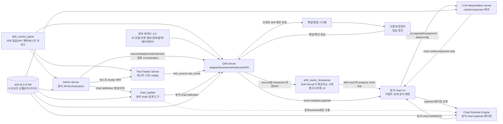
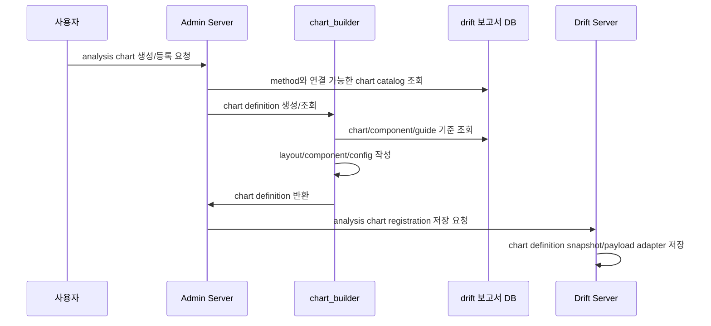
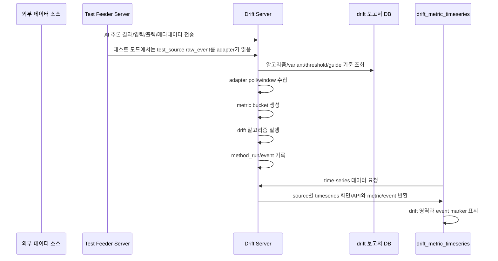
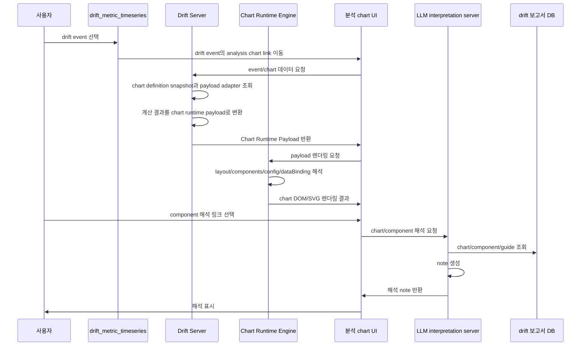
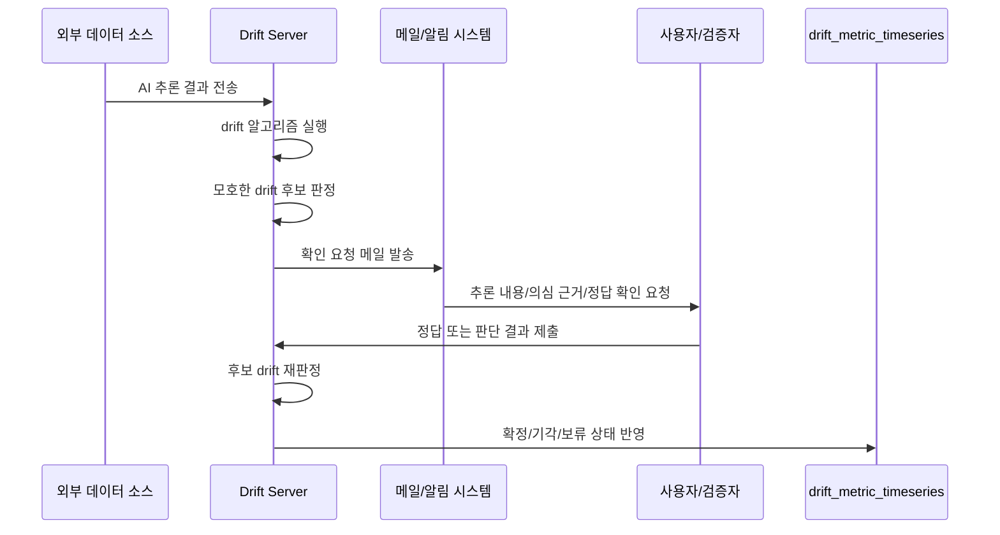

# 드리프트 모니터링 시스템 구성도 및 처리 흐름

## 1. 문서 목적

이 문서는 드리프트 모니터링 시스템의 전체 구성요소와 데이터 흐름을 정리한다. 이후 시스템 구성도, 시퀀스 다이어그램, 화면 흐름도를 그릴 때 기준 자료로 사용한다.

현재 구현된 구성요소와 앞으로 추가해야 할 구성요소를 함께 설명한다. 특히 `drift_control_plane/` 안에 있는 Admin Server, Drift Server, Test Feeder Server, 테스트 하네스의 역할을 별도 구성요소로 구분한다.

## 2. 전체 구성요소

시스템은 크게 다음 구성요소로 나뉜다.

```text
외부 데이터 소스
  -> drift_control_plane
     -> Admin Server
     -> Drift Server
     -> Test Feeder Server
  -> 시계열 모니터링 UI
  -> 분석 차트 UI
  -> Chart Runtime Engine
  -> LLM 해석 서버

공통 지식 기반:
  drift 보고서 폴더의 드리프트 온톨로지 DB

설계 도구:
  chart builder
```

이 문서에서 `Chart Runtime Engine`은 루트 `chart_runtime/`에 있는 공통 렌더링 엔진을 뜻한다. 짧게 `Chart Runtime`이라고 부를 수 있다.

이 문서에서 `drift_control_plane`은 `drift_control_plane/` 폴더 전체를 뜻한다. 이 폴더는 실행 서버 묶음과 통합 테스트 하네스를 관리하는 control-plane 루트이며, 그 안의 `drift_control_plane/drift_server/`가 실제 드리프트 수집/계산을 수행하는 Drift Server 애플리케이션이다.

## 3. 구성요소별 역할

### 3.1 drift 보고서: 중앙 온톨로지와 DB

`drift 보고서/` 폴더는 시스템의 중앙 지식 기반이다.

주요 역할:

- 드리프트 알고리즘 catalog 관리
- 알고리즘 variant 관리
- chart 정의 관리
- chart component 정의 관리
- chart와 component 연결 관계 관리
- chart별 해석 가이드 관리
- component별 해석 가이드 관리
- LLM 해석에 필요한 온톨로지/문서/규칙 관리

대표 DB 개념:

```text
drift_method
algorithm_variant
chart_definition
variant_chart
chart_component
chart_component_usage
chart_component_interpretation_rule
chart_interpretation_guide
llm_component_interpretation_context
llm_chart_interpretation_context
```

이 DB는 실행 서버들이 참조하는 기준 데이터이며, 특정 UI나 서버에 종속되지 않는다.

### 3.2 chart_builder: 분석 차트 설계 도구

`chart_builder/`는 사용자가 드리프트 분석용 chart를 설계하는 도구다.

주요 역할:

- chart layout 설계
- chart component 배치
- component별 config 작성
- chart contract 정의
- chart를 Admin Server orchestration을 거쳐 Drift Server에 등록
- Chart Runtime Payload 생성 및 저장
- Chart Runtime Engine을 통한 preview 렌더링

중요한 경계:

- chart builder는 drift 계산을 직접 수행하지 않는다.
- chart builder는 운영 데이터 수집 서버가 아니다.
- chart builder는 `drift_metric_timeseries` 시계열 화면을 만들거나 설정하지 않는다.
- chart builder는 분석용 chart의 구조와 표현 방법을 정의한다.
- chart builder가 만드는 대상은 drift event에서 연결되는 상세 분석 chart다.
- chart builder가 생성하는 결과물은 chart 코드가 아니라 `layout`, `components`, `config`, `dataBinding`으로 구성된 Chart Runtime Payload다.
- LLM interpretation 서버는 현재 `llm_interpretation_server/`로 분리되어 있으며, `chart_builder/interpretation_server.py`가 남아 있다면 호환용 wrapper로 취급한다.

### 3.3 drift_control_plane: 실행 제어면과 통합 테스트 환경

`drift_control_plane/`은 드리프트 모니터링 실행 서버들을 묶고, 서버 간 API 계약, DB 소유권, 테스트 하네스, 실행 시나리오를 관리하는 control-plane 루트다.

주요 역할:

- `admin_server`, `drift_server`, `test_feeder_server` 실행 경계 관리
- 서버 간 API 계약과 호출 방향 관리
- 테스트 모드와 Harness logical time 기반 end-to-end 검증 지원
- source, adapter, method, chart 등록 흐름의 orchestration 기준 제공
- drift method runtime, event, timeseries, chart payload contract 관리
- 서버별 DB schema 소유권과 reset 정책 관리

중요한 경계:

- `drift_control_plane`은 단일 실행 서버가 아니라 서버 묶음과 테스트 하네스를 포함하는 상위 폴더다.
- Admin Server는 orchestration만 수행하고 drift 계산, bucket 생성, event 생성은 하지 않는다.
- Drift Server는 실제 수집, bucket 생성, drift method 실행, event 저장, timeseries/analysis API를 담당한다.
- Test Feeder Server는 테스트 CSV를 source DB에 주입하는 테스트 source 역할만 한다.
- 서버 간 직접 DB 접근은 금지하고, 명시적 API와 client class를 통해 호출한다.

대표 하위 구성:

```text
drift_control_plane/
  admin_server/
  drift_server/
  test_feeder_server/
  shared/
  testing/
  tests/
```

### 3.4 Admin Server: 관리자 제어와 orchestration 서버

Admin Server는 관리자 화면과 테스트 관제 API의 진입점이다.

주요 역할:

- data source 등록 요청 수신
- source adapter 등록, 시작, 중지, 상태 조회 orchestration
- drift method assignment 등록 orchestration
- analysis chart 생성/등록 orchestration
- 테스트 모드 enable/disable/reset/tick/status 제어
- Drift Server, Test Feeder Server, Chart Builder Server, LLM Interpretation Server health 확인

중요한 경계:

- Admin Server는 `drift_server` 또는 `test_source` DB table을 직접 수정하지 않는다.
- Admin Server는 CSV 파싱, bucket 계산, drift 알고리즘 실행, drift event 생성, chart payload 생성을 직접 수행하지 않는다.
- 실제 상태 저장은 소유 서버 API에 위임한다.

### 3.5 Drift Server: 드리프트 계산 및 운영 기록 서버

Drift Server는 `drift_control_plane/drift_server/`에 있는 data plane 서버다.

주요 역할:

- 외부 시스템에서 인공지능 모델 추론 결과와 관련 데이터를 수신
- source와 adapter 상태 저장
- adapter polling과 window 단위 데이터 수집
- metric bucket 생성
- 등록된 drift 알고리즘 실행
- 드리프트 여부 계산
- method_run 저장
- 드리프트 이벤트 생성
- source별 `drift_metric_timeseries` 화면과 API에 표시할 metric/time-series 데이터 제공
- 분석 chart에 필요한 계산 결과 제공
- chart builder에서 등록된 chart contract에 맞춰 데이터 변환

Drift Server는 시스템의 실행 중심이다. Admin Server를 통해 등록된 source, adapter, method assignment, analysis chart registration을 기준으로 외부 또는 테스트 데이터를 수집하고, 실제 drift 계산 결과를 만든 뒤, 그 결과를 source별 `drift_metric_timeseries` 화면/API와 event analysis API에 공급한다.

v1 기준 핵심 vertical slice:

```text
CASE-010
  -> Test Feeder Server
  -> test_source DB
  -> Drift Server adapter/collector
  -> 10분 metric bucket
  -> ADWIN_MEAN_STREAM method_run
  -> drift_event
  -> CHART-STREAM-001 event analysis payload
  -> LLM Interpretation Server chart job
```

### 3.6 Test Feeder Server: 테스트 source 재생 서버

Test Feeder Server는 운영 데이터 수집 서버가 아니라, 테스트 CSV를 외부 source처럼 재생하는 서버다.

주요 역할:

- `테스트데이터/CASE-*` CSV 읽기
- Harness Clock의 `logicalNow` 기준으로 row를 선택
- `test_source.raw_event`에 raw event 삽입
- feed_state, cursor, start/stop/status 관리
- 테스트 reset 처리

중요한 경계:

- Test Feeder Server는 Drift Server를 직접 호출하지 않는다.
- Test Feeder Server는 drift 계산, bucket 생성, event 생성을 하지 않는다.
- Drift Server는 adapter를 통해 test source DB를 읽는다.

### 3.7 drift_metric_timeseries: 시계열 모니터링 UI

`drift_metric_timeseries/`는 드리프트 상태를 시간축으로 보여주는 UI다.

주요 역할:

- drift metric time-series 표시
- 정상/주의/후보/드리프트/확정 상태 영역 표시
- drift event marker 표시
- 특정 drift 구간 또는 이벤트에서 분석 chart로 이동하는 링크 제공

중요한 경계:

- `drift_metric_timeseries`는 chart builder가 만든 chart가 아니다.
- `drift_metric_timeseries`는 source별 drift 상태를 보여주는 고정된 상위 모니터링 화면이다.
- 운영 관점에서 Drift Server가 source별 timeseries 화면 또는 그 진입 URL/API를 제공한다.
- chart builder가 만든 분석 chart는 이 화면의 drift event link를 통해 열린다.

이 UI는 사용자가 전체 흐름을 먼저 보는 상위 화면이다. 사용자는 시간축에서 이상 구간을 확인하고, 해당 drift event에 연결된 분석 chart를 열어 상세 원인을 확인한다.

### 3.8 분석 chart UI

분석 chart는 `drift_metric_timeseries`에서 drift event를 선택했을 때 열리는 상세 화면이다. chart builder로 설계된 chart 정의와 Drift Server가 제공한 계산 결과 데이터를 Chart Runtime Payload로 결합한 뒤, Chart Runtime Engine이 렌더링한다.

주요 역할:

- 특정 drift event 또는 구간에 대한 상세 분석 시각화
- 분포 변화, feature ranking, error shift, class drift, embedding shift 등 분석 chart 표시
- chart component별 해석 링크 제공
- 요약 지표 카드와 주요 component별 LLM 해석 결과 표시

분석 chart의 데이터는 Drift Server가 만든다. chart builder는 chart 구조와 `dataBinding` contract를 정의하고, Drift Server는 해당 chart가 요구하는 contract와 payload adapter에 맞게 계산 결과를 `payload.data`로 변환해서 공급한다. Chart Runtime Engine은 이 payload를 해석해 실제 DOM/SVG chart를 그린다.

분석 chart와 `drift_metric_timeseries`의 관계:

```text
Drift Server
  -> source별 drift_metric_timeseries 화면/API 제공
  -> drift event marker와 analysis chart link 제공
  -> 사용자가 event link 선택
  -> event analysis API가 chart runtime payload 제공
  -> Chart Runtime Engine이 분석 chart 렌더링
```

### 3.9 Chart Runtime Engine: 공통 차트 렌더링 엔진

`Chart Runtime Engine`은 Chart Runtime Payload를 실제 chart 화면으로 렌더링하는 공통 엔진이다.

주요 역할:

- `payload.layout.areas`를 semantic grid 영역으로 변환
- `payload.components`를 area별 component instance로 배치
- `componentType`에 따라 `trend_line`, `bar_chart`, `state_timeline` 등 component renderer 선택
- `dataBinding.source`로 `payload.data[source]` 조회
- component `config`를 적용해 축, tick, marker, annotation, style, domain 렌더링
- overlay component, 확대 popup, overflow/scroll, responsive sizing 처리

중요한 경계:

- Chart Runtime Engine은 특정 chart id에 종속되면 안 된다.
- chart별 tick, marker, annotation, threshold, label, style 차이는 payload의 `config`와 `data`에 둔다.
- Chart Runtime Engine은 `layout`, `components`, `componentType`, `dataBinding`을 임의로 바꾸지 않는다.
- payload와 Chart Runtime Engine의 계약이 깨지면 chart가 정상적으로 렌더링될 수 없다.

대표 구현 위치:

```text
chart_runtime/chart_runtime.js
chart_runtime/chart_runtime.css
```

### 3.10 LLM interpretation server: 차트 해석 서버

LLM interpretation 서버는 chart와 chart component를 설명하는 별도 공통 서비스다.

주요 역할:

- chart payload, component config, component data, analysis context 수신
- `drift 보고서` DB의 chart/component/guide 정보 조회
- 일반 해석 가이드, chart별 가이드, component별 가이드 조합
- chart-level note 생성
- component-level note 생성
- 해석 결과를 분석 chart UI에 반환

중요한 경계:

- LLM interpretation 서버는 drift 계산을 수행하지 않는다.
- LLM interpretation 서버는 chart를 설계하지 않는다.
- LLM interpretation 서버는 보이는 chart와 데이터, config, guide를 바탕으로 설명을 생성한다.
- 해석 지식의 원천은 `drift 보고서`의 온톨로지 DB다.

## 4. 전체 정적 구성도 초안

아래 Mermaid 다이어그램은 그림 작성 시 기준으로 사용할 수 있는 논리 구성도다.



## 5. 운영 데이터 처리 흐름

### 5.1 기본 drift 감지 흐름

```text
1. Admin Server 또는 운영 설정을 통해 data source, adapter, drift method assignment, analysis chart registration이 등록된다.
2. 외부 시스템이 인공지능 모델 추론 결과와 관련 데이터를 source에 적재하거나 Drift Server가 접근 가능한 source endpoint로 제공한다.
3. 테스트 모드에서는 Test Feeder Server가 CSV row를 Harness logical time 기준으로 `test_source.raw_event`에 적재한다.
4. Drift Server adapter가 source에서 하나의 aggregate interval window를 읽는다.
5. Drift Server collector가 window 데이터를 feature별 metric bucket으로 집계해 저장한다.
6. Drift Server detector가 source별 enabled assignment를 조회하고 등록된 drift method runtime을 실행한다.
7. Drift Server는 method_run을 저장하고, warning 또는 drift 조건이면 drift_event를 생성한다.
8. Drift Server가 제공하는 source별 `drift_metric_timeseries` 화면은 timeseries API를 통해 bucket series와 event marker를 표시한다.
9. 사용자는 시계열 UI에서 특정 drift event 또는 의심 구간을 선택한다.
10. 선택한 drift event에 연결된 분석 chart가 열린다.
11. Drift Server는 해당 chart registration의 chart definition snapshot과 payload adapter를 사용해 Chart Runtime Payload를 생성한다.
12. Chart Runtime Engine은 Chart Runtime Payload를 해석해 분석 chart DOM/SVG를 렌더링한다.
13. 분석 chart UI는 렌더링된 chart를 사용자에게 표시하고 상호작용을 처리한다.
14. 사용자가 chart/component의 해석 링크를 누르면 LLM interpretation server에 해석을 요청한다.
15. LLM interpretation server는 chart payload와 온톨로지 DB의 가이드를 조합해 note를 생성한다.
16. 분석 chart UI는 chart-level 또는 component-level note를 사용자에게 표시한다.
```

### 5.2 모호한 drift의 사용자 확인 흐름

이 시스템은 인공지능 추론 드리프트를 다루므로, drift가 명확하지 않은 경우 실제 정답 확인을 통해 drift 여부를 확정하는 절차가 필요하다. 이 흐름은 현재 v1 구현 범위에서는 제외되어 있으며, 후속 범위로 남아 있다.

```text
1. Drift Server가 외부 추론 데이터를 수신한다.
2. drift 알고리즘 실행 결과가 명확한 drift도 아니고 정상도 아닌 모호한 상태로 판정된다.
3. Drift Server는 해당 추론 사례, 모델 입력/출력, 예측값, confidence, 관련 drift 근거를 묶어 확인 요청을 만든다.
4. Drift Server는 사용자 또는 검증자에게 메일을 보낸다.
5. 메일 내용은 다음을 포함한다.
   - 인공지능 모델이 어떤 입력에 대해 어떤 추론을 했는지
   - 왜 drift 의심 또는 모호 상태로 판단했는지
   - 사용자가 확인해야 할 정답 또는 판단 항목
   - 응답 링크 또는 정답 입력 방법
6. 사용자는 메일 또는 연결된 화면에서 정답을 입력한다.
7. Drift Server는 사용자 응답을 저장한다.
8. Drift Server는 모호했던 drift 후보를 정답 기준으로 재판정한다.
9. 재판정 결과에 따라 drift event를 확정, 기각, 보류 중 하나로 갱신한다.
10. 시계열 UI는 확정 또는 기각된 상태를 시간축에 반영한다.
11. 분석 chart와 LLM 해석은 사용자 검증 결과를 context로 포함해 설명할 수 있다.
```

## 6. 시퀀스 다이어그램 초안

### 6.1 chart 설계 및 등록



### 6.2 drift 감지와 시계열 표시



### 6.3 분석 chart와 LLM 해석



### 6.4 모호한 drift의 human-in-the-loop 확인



## 7. 핵심 데이터 흐름

### 7.1 chart contract 흐름

```text
chart_builder
  -> chart layout
  -> component instance
  -> component config
  -> dataBinding
  -> required data fields
  -> chart contract
  -> Admin Server orchestration
  -> Drift Server analysis chart registration
```

Drift Server는 chart별 contract와 등록된 payload adapter를 기준으로 알고리즘 계산 결과를 chart data로 변환한다.

```text
drift algorithm result
  -> standard drift result format
  -> method_run/drift_event
  -> analysis_chart_registration
  -> chart-specific transform
  -> payload.data
  -> Chart Runtime Payload
  -> Chart Runtime Engine
  -> rendered analysis chart
```

Chart Runtime Payload는 다음 계약을 만족해야 한다.

```text
payload.chartId
payload.layout.areas
payload.components[].componentType
payload.components[].config
payload.components[].dataBinding.source
payload.data[source]
```

`components[].dataBinding.source`가 가리키는 `payload.data[source]`가 없거나, renderer가 요구하는 field가 data row에 없으면 해당 component는 정상 렌더링될 수 없다.

### 7.2 LLM 해석 흐름

```text
analysis chart UI
  -> chart id
  -> chart config
  -> component type
  -> component data
  -> analysis context
  -> LLM Interpretation Server
  -> drift 보고서 DB guide 조회
  -> chart/component note 생성
```

### 7.3 사용자 검증 흐름

```text
ambiguous drift candidate
  -> email confirmation request
  -> human label/answer
  -> drift candidate validation
  -> event status update
  -> time-series UI update
  -> analysis chart context update
```

## 8. 그림 작성 시 강조해야 할 포인트

구성도를 만들 때 다음 관계를 명확히 표현해야 한다.

- `drift 보고서 DB`는 중앙 지식 기반이다.
- `drift_control_plane`은 Admin Server, Drift Server, Test Feeder Server와 테스트 하네스를 묶는 실행 제어면이다.
- `chart_builder`는 drift event에서 열리는 분석 chart를 설계하고, Admin Server orchestration을 거쳐 Drift Server에 analysis chart registration으로 등록된다.
- `chart_builder`의 산출물은 chart 코드가 아니라 Chart Runtime Payload 계약을 만족하는 chart 정의다.
- `chart_builder`는 `drift_metric_timeseries` 시계열 화면과 직접 관계가 없다.
- `Admin Server`는 관리자 control API와 orchestration만 담당하고 직접 DB write나 drift 계산을 하지 않는다.
- `Drift Server`는 외부 또는 테스트 source 데이터를 읽어 bucket을 만들고 drift 알고리즘을 실행하는 data plane 서버다.
- `Test Feeder Server`는 테스트 CSV를 logical time 기준으로 source DB에 주입하는 테스트 source 서버다.
- `drift_metric_timeseries`는 Drift Server가 source별 time-series/event 상태를 보여주기 위해 제공하는 상위 UI다.
- 분석 chart는 `drift_metric_timeseries`에서 특정 drift event를 클릭해 들어가는 상세 화면이다.
- 분석 chart의 데이터는 Drift Server가 계산 결과를 chart contract와 payload adapter에 맞게 `payload.data`로 변환해서 제공한다.
- `Chart Runtime Engine`은 Chart Runtime Payload를 해석해 실제 DOM/SVG chart를 렌더링한다.
- Chart Runtime Payload와 Chart Runtime Engine의 계약 관계는 chart 렌더링 가능 여부를 결정하는 핵심 경계다.
- LLM interpretation server는 chart와 component를 해석하는 별도 공통 서버다.
- 모호한 drift의 human verification workflow는 필요하지만 v1 구현 범위에서는 제외된 후속 기능이다.

## 9. 현재 구현 상태 기준 메모

현재 폴더 기준:

```text
drift_llm_intepretation/
  chart_builder/
  chart_runtime/
  drift_control_plane/
  drift 보고서/
  drift_metric_timeseries/
  llm_interpretation_server/
```

현재 상태:

- `drift 보고서/`에는 온톨로지 DB, schema, importer, chart/guide 문서가 있다.
- `chart_builder/`에는 chart builder 서버, builder UI, chart definition 저장 파일이 있다.
- `chart_runtime/`에는 Chart Runtime Engine 구현인 `chart_runtime.js`와 `chart_runtime.css`가 있다.
- `drift_control_plane/`에는 Admin Server, Drift Server, Test Feeder Server, shared code, testing harness, API/DB/경계 정책 문서가 있다.
- `drift_control_plane/drift_server/`가 실제 드리프트 수집, bucket 생성, method 실행, event/timeseries/analysis API를 담당하는 Drift Server 애플리케이션이다.
- `drift_metric_timeseries/`는 시계열 chart/UI 역할을 담당한다.
- `llm_interpretation_server/`에는 chart/component 해석 서버가 분리되어 있다.
- v1 초기 구현 범위는 `CASE-010 + ADWIN_MEAN_STREAM + CHART-STREAM-001` vertical slice를 end-to-end로 동작시키는 것이다.

향후 목표:

```text
drift_llm_intepretation/
  drift_ontology/ 또는 drift 보고서/
  chart_builder/
  chart_runtime/
  drift_control_plane/
    admin_server/
    drift_server/
    test_feeder_server/
    shared/
    testing/
  drift_metric_timeseries/
  llm_interpretation_server/
```

`chart_builder/interpretation_server.py`는 호환용 wrapper로만 남기고, 실제 서버 구현은 `llm_interpretation_server/interpretation_server.py`에서 관리한다.
